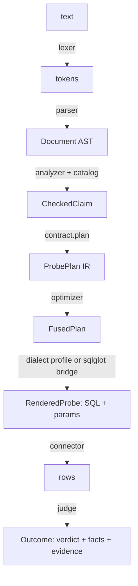

# Architecture

> FactLang is a pipeline: text becomes tokens, tokens become a tree, the tree becomes a checked claim, the claim becomes a measurement plan, the plan becomes SQL, and the rows that come back become a verdict.
> The front end is pure and knows no warehouse; only the dialect knows SQL; only the connector knows a network.
> A strict layer rule, enforced by a test, keeps every module pointing only downwards.

## The pipeline (ASCII)

```
 text
  |  lexer            (never raises)
  v
 tokens
  |  parser           (recovers line by line)
  v
 Document (generic AST: knows no verbs)
  |  analyzer         (checks verb, operands, attributes, names; uses a Catalog)
  v
 CheckedClaim (resolved, typed, immutable) + diagnostics
  |  contract.plan    (the verb's own planner)
  v
 ProbePlan (IR: dialect-free measurement primitives)
  |  optimizer        (de-duplicate, fuse probes)
  v
 FusedPlan
  |  dialect profile  (or the optional sqlglot bridge)
  v
 RenderedProbe (sql template + typed params)
  |  connector        (executes; timeouts, cost guard)
  v
 rows
  |  judge            (derive facts, decide with a predicate)
  v
 Outcome (verdict + facts + evidence)
```

## The pipeline (Mermaid)



Front end (lexer to analyzer) is pure Python and needs no database. This is why `fl.lint`, `fl.format` and `fl.compile` work with no connection at all.

## Layers

A module may import only from modules in strictly lower layers. `tests/test_architecture.py` enforces it, and also checks that the core imports only the Python standard library.

| Layer | Module | Job |
|---|---|---|
| 0 | `diagnostics` | `Span`, `Severity`, `Diagnostic`, caret rendering, JSON |
| 1 | `syntax/tokens` | token kinds |
| 2 | `syntax/lexer` | text to tokens |
| 3 | `syntax/ast` | the generic tree |
| 4 | `syntax/parser`, `syntax/formatter` | tokens to tree; tree to canonical text |
| 5 | `semantics/refs`, `types`, `filters`, `signature` | references, value types, filter trees, verb specs |
| 6 | `semantics/catalog`, `checked` | the catalog protocol and the checked claim |
| 7 | `semantics/identity`, `analyzer` | semantic hash and the analyzer |
| 8 | `ir/` | measurement primitives and metrics |
| 9 | `judge/` | predicates, `Outcome`, `Verdict` |
| 10 | `contract` | `Contract`, `ContractPack` |
| 11 | `packs/standard/` | one file per verb |
| 12 | `sql/` | internal SQL AST, dialect profiles, renderer, optional sqlglot bridge |
| 13 | `optimizer` | probe fusion |
| 14 | `connectors/` | connector protocol and adapters |
| 15 | `engine` | `Checker`: orchestration, sync and async, batching |
| 16 | `api`, `__init__` | the public facade |
| 17 | `agent/`, `cli` | LLM tool schema, MCP server, command line |

Within one layer number there is an order too (for example `refs` before `types` before `filters` before `signature` in layer 5), so even same-layer modules cannot form a cycle.

## Core versus extras

Everything except the sqlglot bridge, the vendor connector adapters, and the MCP server is the **core** and uses only the standard library. Optional libraries (`sqlglot`, `duckdb`, `psycopg`, ...) are imported lazily inside functions, so `pip install factlang` pulls in nothing else. A portability test walks every core module and fails on any third-party import.

## One tree, two printers

Every measurement primitive is first lowered into a small dialect-free SQL tree. The native printer and the sqlglot bridge both start from that same tree, so they cannot disagree about meaning, only about spelling. See [[Dialects]] and [[sqlglot-Bridge]].

## Where the safety rules live

- No raw SQL in claims: the grammar has no place to put it; every literal becomes a typed bind parameter ([[Dialects]]).
- No sampling in verdicts: only `Checker.measure` can accept a sample ([[Measurement-API]]).
- NULL handling: declared per metric in the IR, so every dialect inherits it ([[IR]]).
- Judging never raises: one broken contract cannot sink a batch ([[Judge]]).

## See also

- [[Concepts]]
- [[Design-Decisions]]
- [[Lexer]]
- [[Parser]]
- [[Analyzer]]
- [[IR]]
- [[Dialects]]
- [[Optimizer]]
- [[Connectors]]
- [[Judge]]
